# ☁️ Microsoft Intune Fundamentals

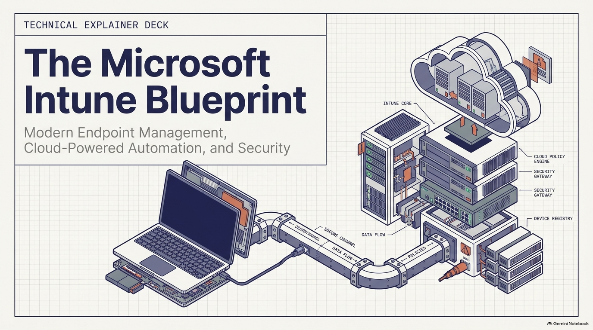

*A visual introduction to the topics covered in these notes.*

> **Manage devices · Protect company data · Improve user experience**

---

## 🧭 Explore the notes

| Foundation | Delivery and device setup | Control and experience |
| --- | --- | --- |
| [01 · What is Intune?](#1-what-is-intune) | [06 · Deployments](#6-deployments) | [09 · Compliance and configuration](#9-compliance-and-configuration-policies) |
| [02 · On-prem versus cloud](#2-on-prem-infrastructure-versus-cloud-based-infrastructure) | [07 · Patching and updates](#7-store-application-windows-patching-office-patching-feature-update-auto-patch) | [10 · PowerShell](#10-powershell-script) |
| [03 · Asset management](#3-asset-management--hardware-and-software-inventory) | [08 · Autopilot](#8-autopilot) | [11 · Co-management](#11-co-management) |
| [04 · VPN](#4-vpn--virtual-private-network) | | [12 · Endpoint analytics](#12-endpoint-analytics) |
| [05 · Remote Help](#5-remote-help-quick-assist-attended-and-unattended) | | [13 · Reporting](#13-reporting-and-monitoring) · [14 · RBAC](#14-rbac--role-based-access-control) |

[Quick revision](#-quick-revision) · [Scenario-based self-check](#-scenario-based-self-check)

## 🗺️ Intune at a glance

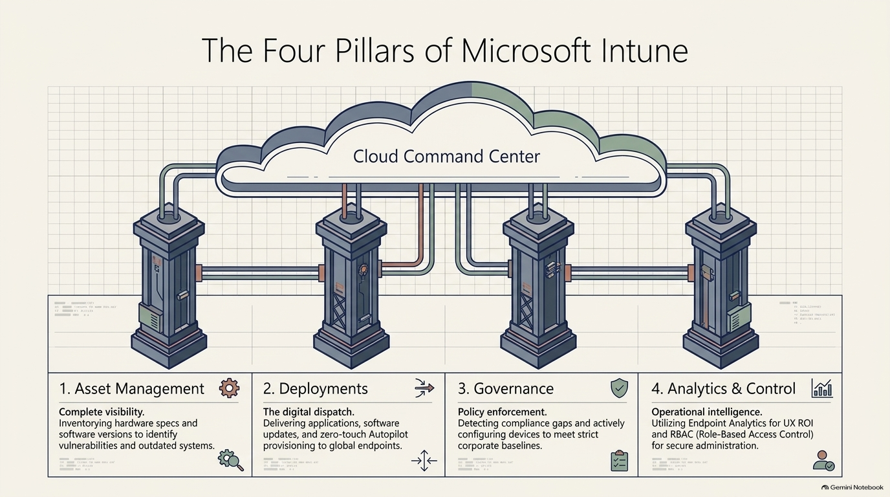

**Use these four groups to navigate the detailed topics below.**

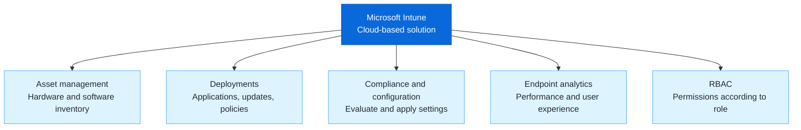

---

## 1. What is Intune?

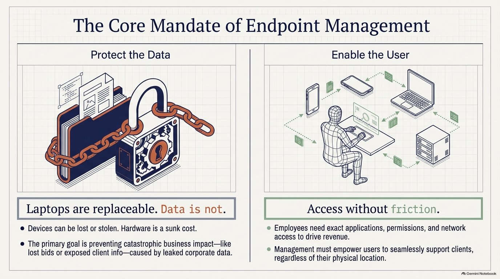

*Connect this with the stolen-laptop example: protecting company data while enabling employees to work.*

**Intune is a cloud-based solution from Microsoft** used to manage devices, configuration, security, and device security compliance.

An organization has laptops, desktops, mobile devices, servers, shared drives, and users. The discussion uses these to explain the organization's infrastructure; this list is not a claim that Intune manages every item in the same way.

The company wants to:

- Protect the data.
- Manage the devices used by employees.
- Give permission to the user: **“What they can do, how they can do, when they can do?”**

### 💡 Example: stolen laptop

The company is more bothered about the **data inside the laptop** than the laptop's price—even if the laptop costs **2 lakh, 3 lakh, or 4 lakh**.

- A person dealing with new company deals loses a laptop. Someone extracts the project bid information, lowers their own bid, and wins the bid.
- The laptop may contain client details, client numbers, mobile numbers, and designations. These should not be exposed on the open internet.
- A data leak can have monetary and non-monetary impact, including impact on the company's name.

The employee uses the infrastructure to develop the business, generate revenue, and support the client.

---

## 2. On-prem infrastructure versus cloud-based infrastructure

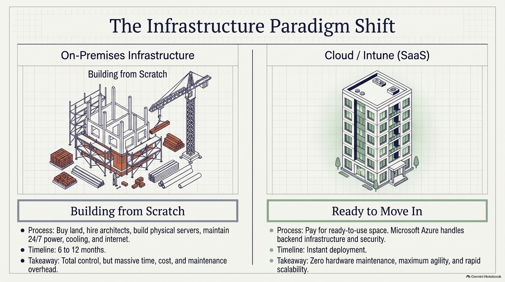

*The 6–12 month timeline illustrates the home-building analogy. Intune manages endpoints; it does not replace every data-center workload, and licensing, connectivity, and device costs still apply.*

**Cloud-based** was introduced as having no dependency on the company's own **on-prem infrastructure** for the service being discussed.

**On-prem infrastructure** means the company purchases and maintains its own infrastructure: servers, a place to keep them, people to maintain them, security, backup, electricity, cooling, and high-speed internet.

### 💡 Example: ready-to-move flat versus building your own home

| Example from the conversation | IT terminology | Main point |
| --- | --- | --- |
| Go to a builder, select the **5th floor XYZ flat**, make payment, get the key, and move into a **ready-to-move flat**. | Cloud | You can start using the available space quickly. |
| Purchase land, call an architect, get the plan, complete construction and renovation, and arrange security, generator, water, and electricity. This may take **6 to 12 months**. | On-prem infrastructure | The land, building, and installed items are yours, and you manage them. |

The on-prem example emphasizes ownership, cost, time, and maintenance. A startup may use a cloud server instead of building all this infrastructure itself.

### Cloud service terminology and examples

- **Infrastructure as a service**: discussed using a cloud server example.
- **Software as a service**: **Gmail**. Open `gmail.com`, log in, type a mail, and send it without installing a mail server on your machine.
- **Microsoft — Azure**.
- **Google — Google Cloud**.
- **Amazon — AWS**.

The conversation distinguishes **Azure cloud service** from **Entra ID**; Entra ID is a different topic.

---

## 3. Asset management — hardware and software inventory

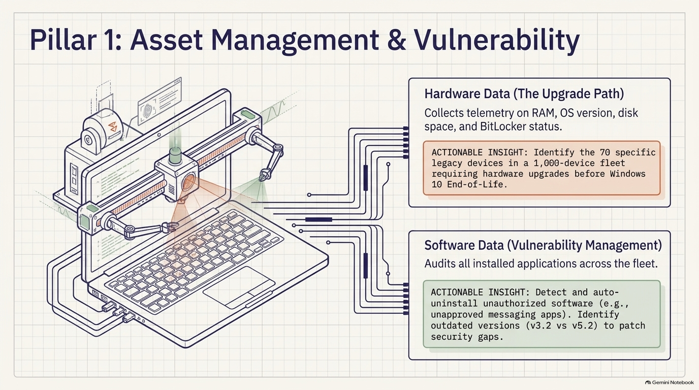

*The same inventory examples: identify Windows 10 devices and software version 3.2 that may need upgrading to 5.2.*

An **asset** can be hardware or software.

| Hardware examples | Software examples |
| --- | --- |
| Desktop, laptop, printer, monitor, network devices | Google Chrome, Mozilla Firefox, VLC Media Player, antivirus applications, Cisco AnyConnect, VPN applications, ServiceNow applications |

**Intune can collect hardware and software inventory.**

### Hardware inventory

The discussion discussed collecting information such as:

- Laptop configuration, including **16 GB RAM**.
- Company and model.
- Disk space, free disk space, and available disk space.
- Whether the machine is **BitLocker enabled or not**.

### Software inventory

Software inventory tells you what software is installed on the device, similar to the list in **Add or Remove Programs**.

The company can identify software that is not approved and take action to uninstall it. **WhatsApp** was used as an example of software a particular company might not approve; this depends on the organization's rules.

### 💡 Example: vulnerability and outdated software

The machine has software version **3.2**, while the vendor's latest version is **5.2**. The old version may have a **loophole**, described in the conversation as a **vulnerability**. A hacker or cyber attacker may use that loophole to access the device.

The discussion connects **vulnerability management** with updating software regularly and installing Windows patches. A user may delay restarting because they are busy, but the update is important to fix vulnerabilities.

### 💡 Example: 1,000 devices and Windows 10

In an environment with **1,000 devices**, inventory shows **70 devices still running Windows 10**.

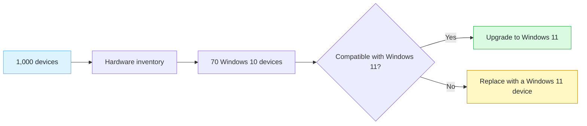

1. Identify the 70 devices.
2. Check whether each machine is compatible with **Windows 11**.
3. If compatible, upgrade to Windows 11.
4. If not compatible, replace it with a new Windows 11 device.

This was an example scenario about using inventory to make a decision; it is not an operating-system lifecycle reference.

---

## 4. VPN — Virtual Private Network

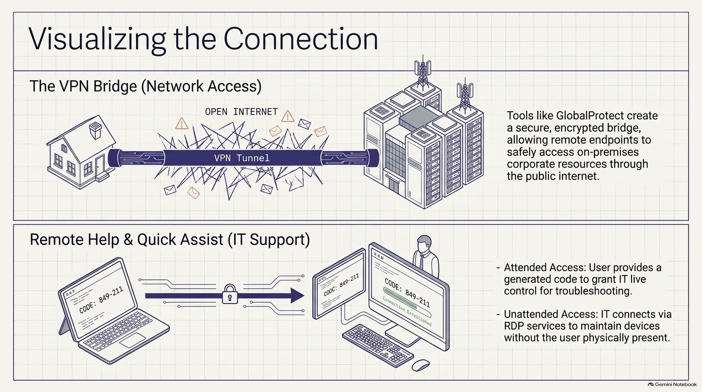

*VPN connects the employee to the company network; remote assistance helps troubleshoot a device. Attended and unattended support depend on the tool, platform, and configuration.*

**VPN** stands for **Virtual Private Network**.

The conversation describes a VPN as a separate tunnel or bridge between the public network and the private company network, with authentication to allow the user into the company's network.

### 💡 Example: connecting from home to the company

You cannot run a physical wire from your home to an office many kilometres away. VPN software creates a **virtual connection** to the company's **on-premises network**.

Examples used: **Cisco AnyConnect** and **GlobalProtect**.

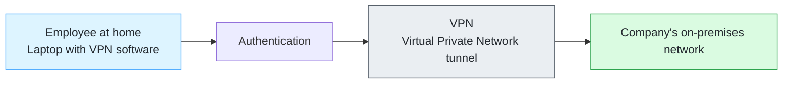

---

## 5. Remote Help, Quick Assist, attended and unattended

**Remote Help** was introduced as a way to connect remotely to a machine, troubleshoot, and fix an issue.

### 💡 Example: troubleshooting from India

The person providing support is in **India** and remotely connects to another person's machine to take control and fix the issue.

**Quick Assist** was discussed as a Microsoft tool available on Windows 11. The conversation describes using a code to establish the remote assistance connection.

| Term | Explanation used in the conversation |
| --- | --- |
| **Attended** | Someone is physically present, attends to the code, and allows access to the device. |
| **Unattended** | No one is physically present, and the support person can connect through the supported remote-control setup. |

The discussion also discussed Intune-managed and co-managed devices, an Intune agent, and the **Remote Help application** being installed on the device. The transcript does not clearly establish platform-specific prerequisites or unattended support limits.

---

## 6. Deployments

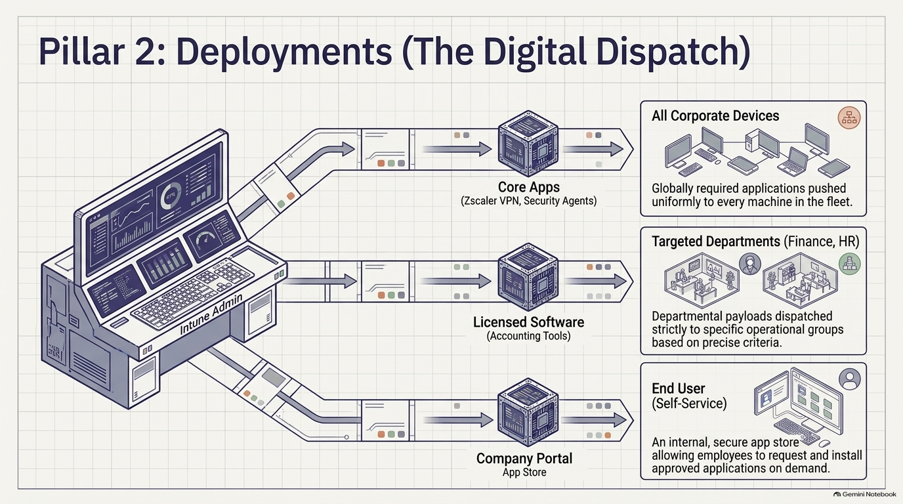

*Relate the delivery paths to the postman example: the requester supplies the setup file, target users or devices, and timeline. Company Portal availability depends on assignment and approval.*

**Deployment** was explained through installing applications, updates, feature updates, and assigning policies or settings.

### 💡 Everyday example: army deployed in Punjab

The phrase **“army deployed in Punjab”** was used to introduce the normal-life meaning of deployment before moving to Intune examples.

### Policy deployment examples

- Change the machine **wallpaper**.
- Change the machine **sleep time**.
- Configure a template and **deploy the template** or **assign the template**.

### 💡 Example: Diwali wallpaper

The company decides to change the wallpaper for **Diwali**, using a theme such as **“celebrate the Diwali with security.”** The Intune admin deploys the company-approved wallpaper. The company may choose a different theme or compliance policy training message the next month.

### 💡 Example: Intune admin as a postman

The Intune admin is **“working as a postman”**: picking up letters and dropping them at the correct destination.

Similarly, the admin receives instructions to deploy an **XYZ application**, **XYZ policy**, or **XYZ setting** and uses the appropriate Intune feature to deliver it.

The requester should supply the necessary information:

- Application **setup file** and configuration information.
- Which users, devices, or particular location should receive it.
- Timeline: immediately, after two days, after a month, or in a **phase-wise manner**.

**Same application example:** Richa requests deployment of **VLC Media Player**. The admin knows how to deploy it but needs the setup file and deployment requirements from the requester.

The discussion describes obtaining the approved setup file from the requester as the preferred practice, rather than independently choosing a generic download.

---

## 7. Store application, Windows patching, Office patching, feature update, Auto patch

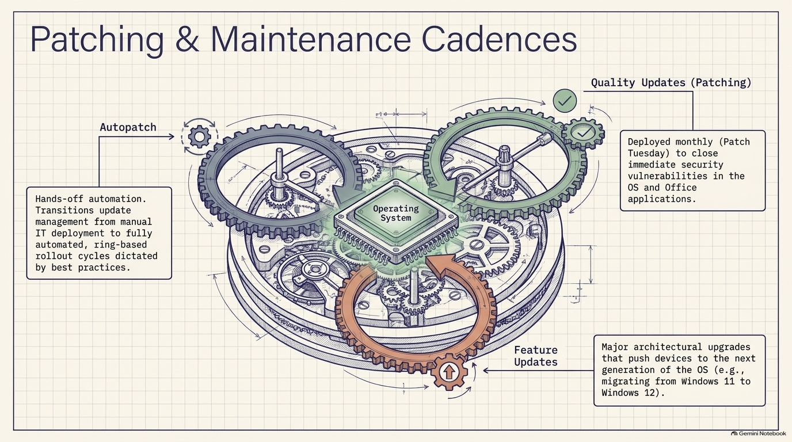

*Read this alongside the distinction between patches that address vulnerabilities and feature updates that introduce operating-system changes.*

| Term | Explanation and same examples from the conversation |
| --- | --- |
| **Store application** | **Microsoft Store** was compared with **Google Play Store** on a mobile. Store applications can be deployed through Intune. |
| **Windows patching** | Microsoft releases patches on the **second Tuesday** of the month. Configure policy to install patches that protect against vulnerabilities. |
| **Office patching** | Update applications such as **Word, Excel, and PowerPoint**. The discussion discussed checking version information in the application's account/settings area. |
| **Feature update** | The discussion used **Windows 10 to Windows 11** and **Windows 11 to Windows 12** as upgrade examples. The latter is retained as a conversation example, not a release or support claim. |
| **Auto patch** | Introduced as automating the update work. The same everyday example was a **mixer**: press a button and the chutney is ready. |

The discussion distinguishes patching to fix vulnerabilities from a feature upgrade. Detailed configuration was left for later sessions.

---

## 8. Autopilot

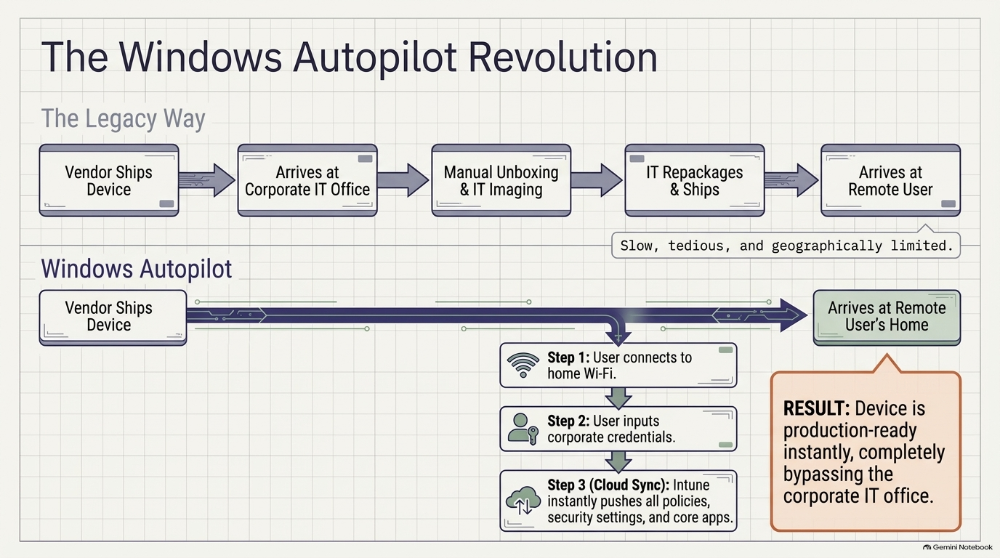

*The Intune admin prepares the required configuration before the employee connects and signs in.*

**Autopilot** was introduced as an important topic for an **Intune admin**.

### 💡 Example: joining a company during COVID

During **COVID**, movement restrictions prevent a new employee from going to the office to collect a laptop prepared by the IT department.

### 📦 Autopilot journey

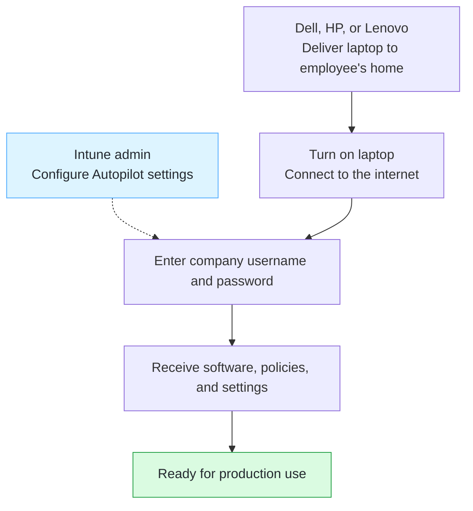

With the Autopilot scenario described in the conversation:

1. A vendor such as **Dell, HP, or Lenovo** delivers the laptop directly to the employee's home.
2. The employee turns on the laptop and connects it to the internet.
3. The employee enters the new company's **username and password**.
4. The machine receives the required software, policies, and settings.
5. The machine is automatically configured and becomes ready for **production use**.

The **Intune admin** configures the Autopilot settings in the backend. The device can receive the company's approved configuration wherever the employee is located.

### 💡 Analogy: airplane autopilot

The discussion compares this with an airplane continuing to fly in **autopilot mode**, using the example of the pilot going to the washroom. The point of the analogy is automatic operation after the required setup.

### Global policy, local policy, and department-specific applications

- **Global policy** applies across the company, including employees in India and elsewhere.
- **Local policy** may apply to India or a particular location such as **Tamil Nadu**. Leave and sick leave were used as examples.
- Common applications such as **Office** and **Zscaler** were discussed as applications that may be needed regardless of department.
- **HR** may need HR-specific applications.
- **IT** may need IT-specific applications.
- **Finance** may need an application such as **Tally**.

### Licensed application and Company Portal

For a **licensed application**, the employee may need to request **license approval**. Some companies install department-specific applications by default; the approach depends on company strategy.

The **company self-service portal**, called **Company Portal**, was discussed as a place where a user can select and install available applications, subject to the company's approval and licensing process.

---

## 9. Compliance and configuration policies

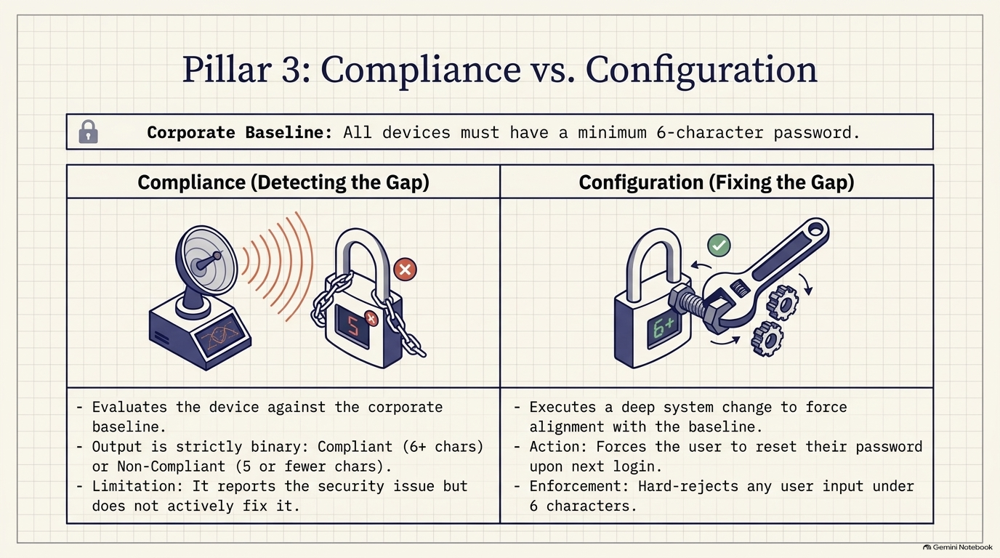

*The six-character password is the original conversation example. Enforcement depends on the device and applicable policy.*

The key terminology is **baseline**, **compliant**, **non-compliant**, **compliance policy**, and **configuration profile**.

| Term | Main distinction taught in the conversation |
| --- | --- |
| **Compliance** | Evaluate against the baseline and report whether a machine is **compliant or non-compliant**. |
| **Configuration** | Apply settings to address the gap: **“fixing the gap.”** |

> [!TIP]
> **Compliance:** “Does the device meet the baseline?”
> **Configuration:** Apply the settings for “fixing the gap.”

### 💡 Everyday example: office attendance

The company sets a baseline:

> In a month, at least for **12 days**, you should be in office for at least **seven hours per day**.

- Employees meeting the baseline are **compliant**.
- Employees not meeting the baseline are **non-compliant**.
- The discussion describes **40 compliant** and **60 non-compliant** employees out of 100.
- Actions such as a salary or allowance deduction were used to illustrate taking action after identifying the gap. This is the discussion analogy for configuration.

### 💻 Technical example: minimum operating system Windows 11

The baseline is **minimum operating system Windows 11**.

Out of **100 machines**:

- **60 Windows 11 machines** are compliant.
- **40 Windows 10 machines** are non-compliant.

The compliance check identifies the machines against the stated baseline.

### 💻 Technical example: minimum login password of six characters

The company wants to know which machines do not meet a **minimum login password of six characters**.

1. Create and deploy a **compliance policy**.
2. The report shows **40 devices compliant** and **60 devices non-compliant** out of 100.
3. The non-compliant examples have passwords of **five, four, three, or two characters**.
4. The compliance policy identifies the result; in this example, it does not change those passwords.
5. Use a **configuration profile** to enforce **minimum password length should be 6**.
6. The discussion describes the user changing/resetting the password and having to meet that minimum.

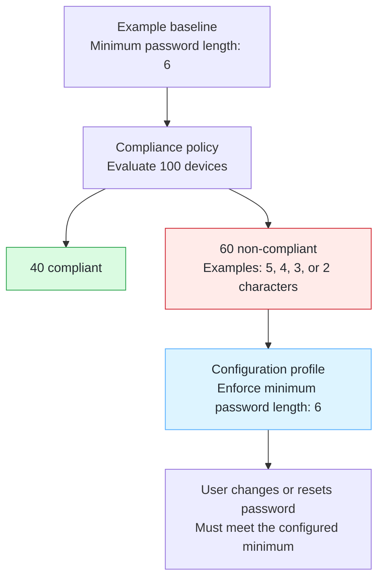

The six-character value is the conversation's example, not a password-security recommendation. Exact enforcement behavior depends on the device and applicable policy.

---

## 10. PowerShell script

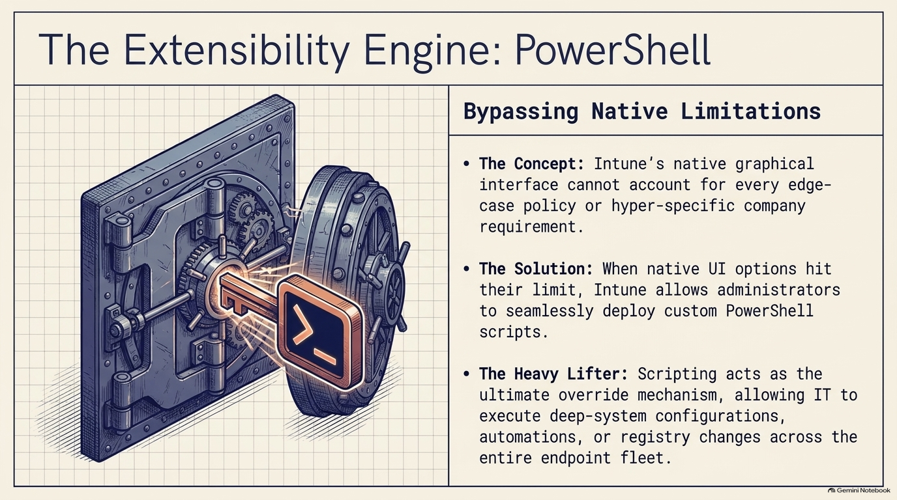

*The Hanumanji analogy illustrates scripting as a way to carry out additional tasks. What a script can do depends on supported APIs, permissions, and the device.*

**PowerShell** was discussed for requirements where Intune does not provide a built-in option to configure the requested setting.

### 💡 Analogy: Hanumanji

The instructor compared PowerShell in Intune to **Hanumanji**, referring to Hanumanji doing Ram's work. The teaching point was that scripting can help accomplish additional tasks when a direct Intune option is unavailable.

PowerShell knowledge was introduced as useful; no script was demonstrated in this session.

---

## 11. Co-management

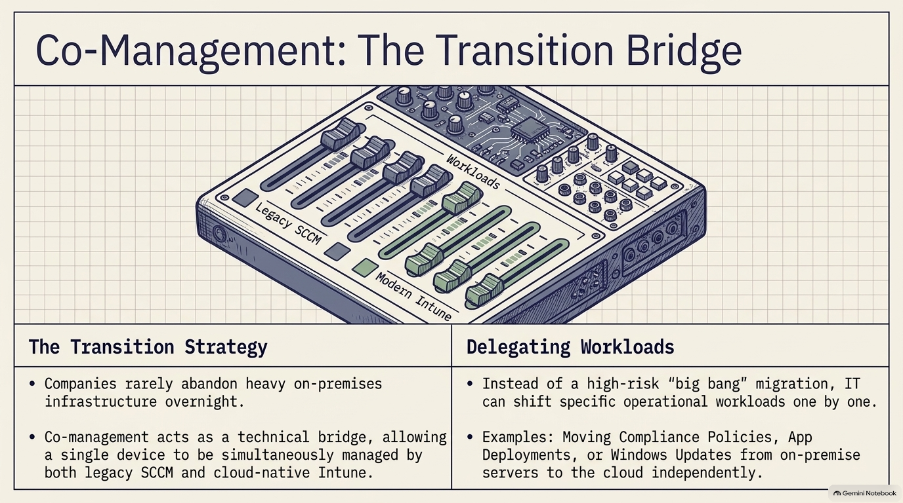

*The housewife and maid example explains moving selected workloads. Co-management can also continue as an ongoing management arrangement.*

A **co-managed** machine is managed through both **SCCM** and **Intune**. The discussion explains this in terms of distributing **workloads** between the two management systems.

Workload examples discussed include patching, applications, device policies, and **Windows Update for Business**.

### 💡 Example: housewife, maid, and seven workloads

The instructor compares **SCCM** to a **housewife** doing multiple jobs: **cleaning, dusting, cooking, clothing**, and other work—described as **seven workloads**.

- A **maid**, representing **Intune**, is hired.
- The **cleaning workload** is moved from the housewife to the maid.
- Other workloads remain with the housewife until they are moved.

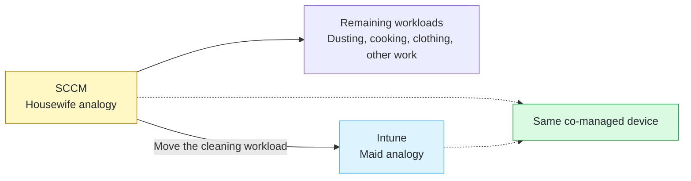

The point is moving responsibility for selected workloads while both systems participate in managing the device.

### 💡 Example: bridge and transitioning phase

The discussion describes co-management as a **bridge** and a **transitioning phase** from SCCM to Intune: move work gradually, reduce on-prem infrastructure, and save infrastructure cost.

This describes the migration scenario described in the conversation; it is not a requirement that every co-management deployment be temporary. The word **hybrid** was also used in conversation, without a detailed distinction between identity join state and co-management.

---

## 12. Endpoint analytics

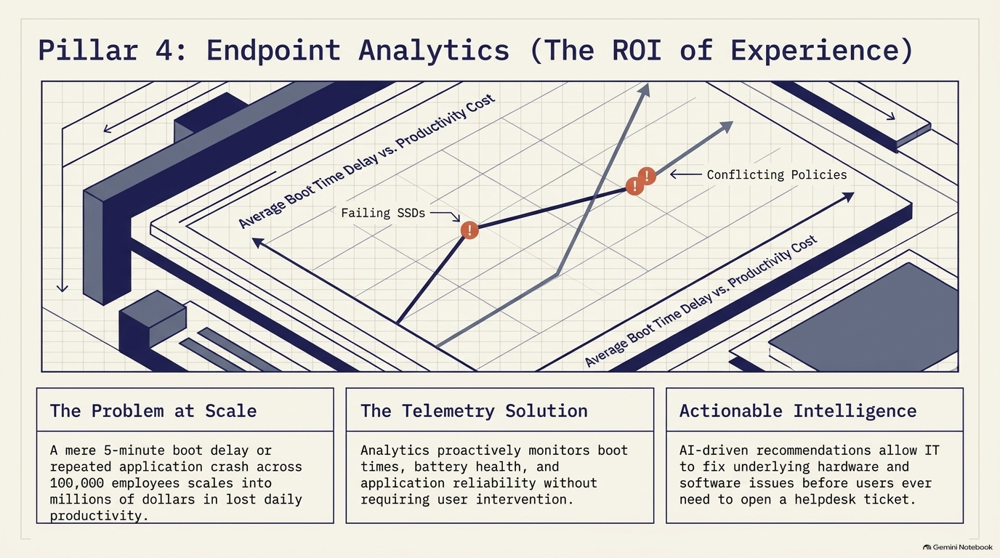

*Use Richa and Sarkar’s laptops and the Teams-crashing example to connect device performance with employee experience. The illustration’s monetary figures are illustrative, not a verified calculation from the transcript.*

An **endpoint** is a device such as a **desktop, laptop, or mobile device**.

**Endpoint analytics** was introduced as reports and recommendations used to understand device performance and improve **user experience**.

### 💡 Example: Richa and Sarkar's laptops

**Richa and Sarkar** join the same company, on the same day, in the same department, and receive the same laptop model.

After some time, their laptops take different amounts of time to reach the desktop screen. The discussion mentions **five minutes**, then discusses a **three-minute** and a **ten-minute** difference; the transcript does not consistently preserve the exact comparison.

The main question is: why do similar devices give different performance? Use analysis to find the cause and fix the issue.

### 💡 Example: Teams crashing

An application such as **Teams** crashes after opening. This gives the employee a poor **user experience**.

The discussion refers to **XMO — Experience Management Department**, focused on improving user experience.

### 💡 Example: lost time across a large company

The discussion asks you to multiply a few minutes of delay across **1 lakh employees** and repeated working days to understand the monetary impact. The transcript's numerical calculation is unclear, so no total is inferred here.

Areas discussed for investigation and recommendations:

- Machine boot time and machine crashes.
- Application issues and application upgrades.
- Conflicting policies and settings.
- Device performance, battery, and disk/SSD-related recommendations.

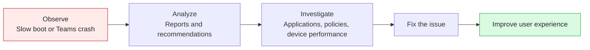

The aim is to find the issue, fix it, and improve the device's performance and the user's experience.

---

## 13. Reporting and monitoring

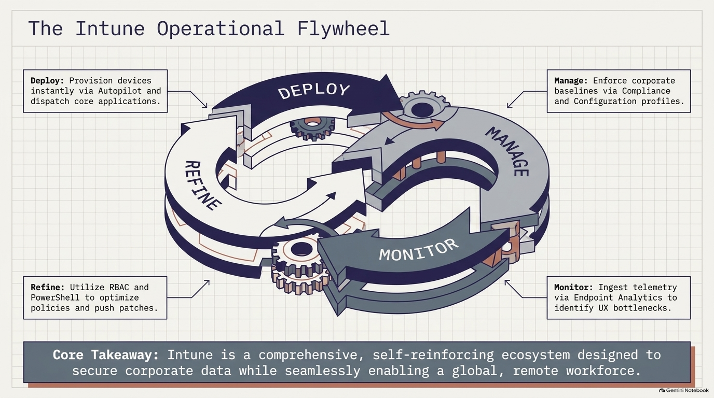

*After deploying Google Chrome, check success and failure reports, investigate problems, and use the findings to improve the next deployment.*

### 💡 Example: Google Chrome deployment

After deploying **Google Chrome**, check:

- How many machines received the deployment?
- On how many machines was it successful?
- On how many machines did it fail?

**Reporting** shows the outcome. **Monitoring** follows deployment status and ongoing health. The discussion also mentions monitoring Intune licensing, health, and changes.

---

## 14. RBAC — role-based access control

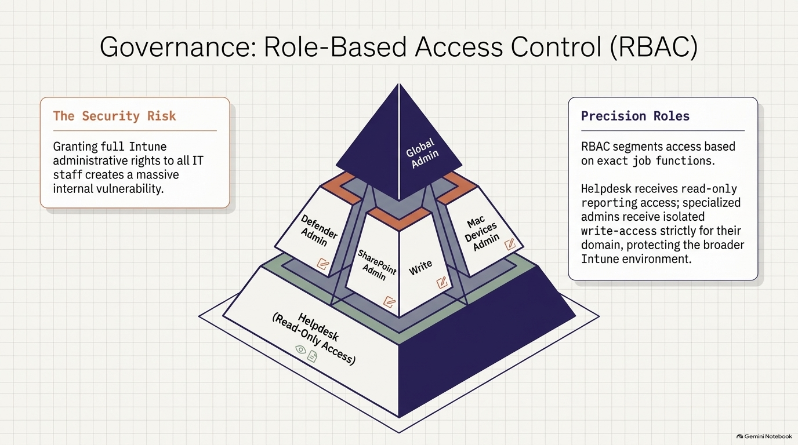

*Connect this with the HR-folder example and the distinction between Intune admin access and read-only rights. Roles shown in the illustration are conceptual examples.*

**RBAC** means **role-based access control**: assign permissions according to the person's role and work.

### 💡 Example: HR folder and marketing employee

An **HR folder** should not automatically be accessible to someone from **marketing**. Access depends on the permissions granted for that role.

### 💡 Example: Intune admin and read-only rights

- An **Intune admin** may need rights to read, write, create policies, modify policies, or delete policies.
- Another employee may need **read-only rights**.
- Teams may specialize in **Intune, Entra, OneDrive, SharePoint, Defender, or Mac**.
- The conversation uses an **Intune expert** and an **Entra expert** to explain why access should match the area of responsibility.

The discussion closes by emphasizing basic knowledge across technologies and expertise in the area being managed in production.

---

## ⚡ Quick revision

- **Intune:** cloud-based solution; manage devices and protect company data.
- **Asset management:** hardware and software inventory for informed action.
- **VPN:** virtual connection to the company network.
- **Remote Help:** remote troubleshooting; attended and unattended concepts.
- **Deployment:** deliver applications, updates, policies, and settings to the intended target.
- **Autopilot:** automatically prepare a device using the company's configured setup.
- **Compliance:** evaluate against a baseline; compliant or non-compliant.
- **Configuration:** apply settings; “fixing the gap.”
- **PowerShell:** scripting for additional configuration requirements.
- **Co-management:** SCCM and Intune manage selected workloads on the same device.
- **Endpoint analytics:** reports and recommendations to improve performance and user experience.
- **Reporting and monitoring:** check outcomes and ongoing status.
- **RBAC:** permissions according to role.

---

## 🧩 Scenario-based self-check

Use the same approach emphasized in the conversation: ask **“why?”** and **“what?”** before choosing an Intune option. Each question below uses an example already discussed in these notes.

<strong>1. A laptop costing 2 lakh, 3 lakh, or 4 lakh is stolen. What is the company most concerned about?</strong>

The **data inside the laptop**: project bid information, client details, mobile numbers, and designations. Losing that data can affect business deals, revenue, and the company's name. Protecting the device supports the larger goal of protecting company data.

<strong>2. Out of 1,000 devices, 70 still run Windows 10. What information helps you decide the next action?</strong>

Use **hardware inventory** to identify those 70 machines and evaluate Windows 11 compatibility. Upgrade compatible machines; replace machines that cannot meet the requirement. This is the original inventory scenario, not an operating-system lifecycle reference.

<strong>3. Richa asks you to deploy VLC Media Player. What do you need before deployment?</strong>

Obtain the approved **setup file**, configuration information, target users or devices, location where relevant, and timeline. Confirm whether the request is immediate or **phase-wise**. The **postman** analogy explains the responsibility: deliver the requested application to the correct destination using the appropriate deployment feature.

<strong>4. A new employee cannot visit the office during COVID. Which scenario explains device preparation at home?</strong>

**Autopilot**: the vendor delivers the laptop, the employee connects it to the internet and signs in with the company's username and password, and the device receives the configured software, policies, and settings. The Intune admin prepares the required backend configuration.

<strong>5. A six-character password baseline gives 40 compliant and 60 non-compliant devices. Which policy identifies the gap, and which applies the setting?</strong>

The **compliance policy** evaluates the baseline and reports **compliant or non-compliant**. The **configuration profile** applies the minimum password-length setting—**“fixing the gap.”** The six-character value belongs to the original example; it is not a security recommendation, and enforcement depends on the device and policy.

<strong>6. In the housewife and maid example, what does transferring the cleaning work represent?</strong>

Moving a **workload** from **SCCM** to **Intune** while both participate in managing the same device. This explains **co-management**. The bridge analogy describes a gradual migration scenario; it does not require every co-management arrangement to be temporary.

<strong>7. Richa and Sarkar received the same laptop model, but performance differs. Where do you begin?</strong>

Use **Endpoint analytics** reports and recommendations to investigate boot time, application failures, conflicting policies, and device performance. The **Teams crashing** example also belongs here: the aim is to find the issue and improve **user experience**.

<strong>8. Google Chrome was deployed. What should you check next?</strong>

Use **reporting and monitoring** to check how many machines received the deployment, how many succeeded, and how many failed. Investigate failures rather than treating deployment alone as proof of success.

<strong>9. Does a marketing employee automatically need access to the HR folder?</strong>

No. Use **RBAC — role-based access control** to give permissions according to responsibility. The same principle explains why one person may need Intune admin permissions while another needs **read-only rights**.

